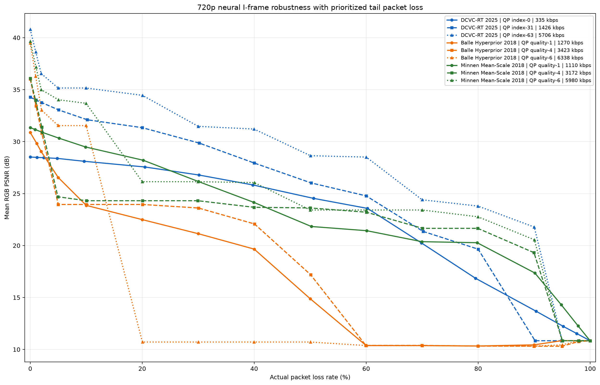

# 720P 多 I 帧神经网络、多质量档位容错与实时自适应实验

## 结论

本实验在同一台 NVIDIA GeForce RTX 3070、同一组 32 张真实 1280×720
自然视频帧上，对 3 个神经 I 帧模型各取 3 个质量档位，共测试 9 个组合。
每个真实熵编码码流都按 1400 bytes 分包，并按 `y3 → y2 → y1 → z`
从尾部优先丢包。

- 在本组离散工作点中，DCVC-RT 的码率—失真效率和受控尾丢包容错性最好。
  QP index-63 在 0%、10%、30%、50%、70% 丢包时分别为 40.81、35.16、
  31.47、28.65、24.41 dB，平均码率 5706 kbps。
- 低码率下，DCVC-RT index-0 只需 335 kbps；0%～10% 丢包仍保持
  28.52～28.11 dB。若目标是 28 dB，它在本实验中是 0%～10% 丢包的
  最低码率选择。
- Minnen Mean-Scale quality-1 是值得保留的实时备选：1110 kbps、无丢包
  31.35 dB、编码/解码 24.67/21.32 FPS；20% 丢包时仍为 28.21 dB。
- Balle Hyperprior 的 3 个工作点均没有进入本实验的码率—PSNR—可解码率
  Pareto 前沿。尤其 quality-6 从 10% 的 31.54 dB 降到 20% 的 10.72 dB；
  这是缺少一个交错通道组后零值填充导致的崩塌，说明普通非渐进图像模型
  不能仅靠“切成四段”获得可靠的可伸缩性。
- 曲线是**有优先级的受控尾丢包**结果，不是随机公网丢包结果。若网络随机
  丢到头部的 `z` 或长度头，质量会比本曲线差得多；实际系统必须为头部、
  `z`、`y0` 提供重传、复制或更强 FEC，才能接近这些曲线。



## 模型、QP 与平均码率

DCVC-RT 的 `index-0/31/63` 是该模型内部 0～63 的 QP 索引；CompressAI
模型的 `quality-1/4/6` 是各自预训练工作点，不是同一物理量。它们只能作为
“模型特定 QP/质量档”参与端到端选择，数字本身不能跨模型直接比较。

平均码率按“源视频 14.75 FPS 的每一帧都独立编码为 I 帧”计算，包含本实验
20-byte 分层长度头，不包含 IP/UDP/RTP 头。

| 模型 | QP/质量档 | 平均码率 | bpp | 0% 丢包 PSNR | 编码 | 解码 |
|---|---:|---:|---:|---:|---:|---:|
| DCVC-RT 2025 | index-0 | 335 kbps | 0.025 | 28.52 dB | 82.28 ms / 12.15 FPS | 64.05 ms / 15.61 FPS |
| DCVC-RT 2025 | index-31 | 1426 kbps | 0.105 | 34.28 dB | 81.87 ms / 12.22 FPS | 63.85 ms / 15.66 FPS |
| DCVC-RT 2025 | index-63 | 5706 kbps | 0.420 | 40.81 dB | 82.08 ms / 12.18 FPS | 66.72 ms / 14.99 FPS |
| Balle Hyperprior 2018 | quality-1 | 1270 kbps | 0.093 | 30.88 dB | 40.49 ms / 24.70 FPS | 46.86 ms / 21.34 FPS |
| Balle Hyperprior 2018 | quality-4 | 3423 kbps | 0.252 | 36.02 dB | 40.94 ms / 24.43 FPS | 48.74 ms / 20.52 FPS |
| Balle Hyperprior 2018 | quality-6 | 6338 kbps | 0.466 | 39.48 dB | 70.10 ms / 14.26 FPS | 83.82 ms / 11.93 FPS |
| Minnen Mean-Scale 2018 | quality-1 | 1110 kbps | 0.082 | 31.35 dB | 40.54 ms / 24.67 FPS | 46.91 ms / 21.32 FPS |
| Minnen Mean-Scale 2018 | quality-4 | 3172 kbps | 0.233 | 36.09 dB | 41.29 ms / 24.22 FPS | 48.63 ms / 20.56 FPS |
| Minnen Mean-Scale 2018 | quality-6 | 5980 kbps | 0.440 | 39.64 dB | 71.75 ms / 13.94 FPS | 85.38 ms / 11.71 FPS |

计时使用模型原生 `compress/decompress`，32 帧中前 5 帧作为 GPU 预热、不计入
统计。DCVC-RT 使用当前安装的 PyTorch fallback，没有启用项目的优化 CUDA
算子，因此这里是本机当前部署的实测值，不是论文优化实现的性能上限。

## 关键丢包点 PSNR

下表均为 32 帧平均 RGB PSNR。100% 可解码表示每一帧至少仍保有完整 `z`；
当 `z` 不完整时以中性灰 concealment 计算 PSNR，但不计作成功解码。

| 模型 + QP | 0% | 10% | 30% | 50% | 70% | 80% |
|---|---:|---:|---:|---:|---:|---:|
| DCVC-RT index-0 | 28.52 | 28.11 | 26.79 | 24.54 | 20.25 (78.1%) | 16.85 (53.1%) |
| DCVC-RT index-31 | 34.28 | 32.10 | 29.86 | 26.03 (96.9%) | 21.36 (84.4%) | 19.65 (71.9%) |
| DCVC-RT index-63 | 40.81 | 35.16 | 31.47 | 28.65 | 24.41 | 23.80 (96.9%) |
| Balle quality-1 | 30.88 | 23.87 | 21.14 | 14.88 | 10.37 | 10.33 |
| Balle quality-4 | 36.02 | 23.95 | 23.61 | 17.20 | 10.39 | 10.33 |
| Balle quality-6 | 39.48 | 31.54 | 10.72 | 10.72 | 10.37 | 10.34 |
| Minnen quality-1 | 31.35 | 29.49 | 26.16 | 21.83 | 20.37 | 20.27 |
| Minnen quality-4 | 36.09 | 24.31 | 24.31 | 23.62 | 21.66 | 21.66 |
| Minnen quality-6 | 39.64 | 33.69 | 26.14 | 23.42 | 23.42 | 22.77 |

括号中仅标出低于 100% 的可解码帧比例。完整数据见
[`curve_data.csv`](results/multimodel_i_packet_loss/curve_data.csv)，可解码率曲线见
[`decodability_vs_packet_loss.png`](results/multimodel_i_packet_loss/decodability_vs_packet_loss.png)。

## 公平性与码流构造

所有模型均使用实际 rANS 熵码流，统一封装为：

```text
20-byte lengths header | z | y0 | y1 | y2 | y3
```

DCVC-RT 原生具有四阶段空间先验，`y0/y1/y2/y3` 是模型自己的渐进掩码层。
Balle Hyperprior 和 Minnen Mean-Scale 原生只有 `z/y`，为了测试相同的分层传输，
本实验把 `y` 按通道索引模 4 交错为四组，并把每组独立熵编码。丢失组在 Balle
中置零，在 Mean-Scale 中置为超先验预测均值。这是实验传输封装，不是
CompressAI 官方文件容器，也不代表两个模型受过渐进解码训练。

完整五流重构与模型原生解码逐帧核对；六个 CompressAI 工作点中的最大绝对
PSNR 差为 `1.051e-5 dB`，远低于 `1e-4 dB` 验收阈值。因而曲线中的退化来自
删除完整熵码流分量，而不是封装本身改变了无丢包重构。

每帧字节串切成最多 1400 bytes 的包，从尾部删除整数个包。若某个分量只收到
一部分，该分量及其后续分量全部丢弃，不尝试用截断 rANS 继续解码。全序列用
最大余数法分配整数丢包数，使 32 帧的实际丢包率尽量接近目标 0%、1%、2%、
5%、10%、20%、30%、40%、50%、60%、70%、80%、90%、95%、98%、100%。

## 动态自适应方案

机器可读选择表
[`adaptive_min_bitrate_policy.csv`](results/multimodel_i_packet_loss/adaptive_min_bitrate_policy.csv)
对每个测试丢包点和 24/28/30/32/35/38 dB 目标，选择同时满足“平均 PSNR”和
“至少 99% 帧可解码”的最低平均码率组合。几个可直接使用的边界如下：

| PSNR 目标 | 建议工作点（按接收端丢包率） |
|---|---|
| 24 dB | 0%～50%：DCVC-RT index-0；60%～70%：DCVC-RT index-63；80% 起无满足组合 |
| 28 dB | 0%～10%：DCVC-RT index-0；20%：Minnen quality-1；30%：DCVC-RT index-31；40%～60%：DCVC-RT index-63；70% 起无满足组合 |
| 30 dB | 0%～5%：Minnen quality-1；10%～20%：DCVC-RT index-31；30%～40%：DCVC-RT index-63；50% 起无满足组合 |
| 32 dB | 0%～10%：DCVC-RT index-31；20%：DCVC-RT index-63；30% 起无满足组合 |
| 35 dB | 0%：Minnen quality-4；5%～10%：DCVC-RT index-63；20% 起无满足组合 |

推荐控制器按以下方式使用这些离散测量，而不是每收到一个丢包反馈就直接切换：

1. 收端按 1～2 秒窗口统计包丢失率，同时反馈可解码帧率和有效吞吐；发送端对
   PLR 做 EMA，并取表中**不低于当前 PLR 的上一个测试档位**，避免乐观插值。
2. 先过滤接收端未安装的模型、超过可用码率的组合，以及不能满足 I 帧截止时间
   的组合，再按目标 PSNR 从策略表选择最低码率工作点。正常 GOP 中应按 I 帧
   周期检查截止时间，而不是要求 I 模型独自达到视频总帧率。
3. 降档连续 2 个窗口即执行，升档至少连续 3 个稳定窗口；设置约 2 个百分点的
   PLR 回差，减少边界附近振荡。
4. 模型 ID、质量档、五段长度和校验信息放在可靠头中；模型或 QP 只在新的独立
   I/IDR 帧切换，不能在依赖旧参考的 P 帧中途切换。
5. 对 `header/z/y0` 使用更强 FEC、复制或限时重传，对 `y2/y3` 使用普通保护并
   允许超时丢弃。若底层只能随机丢包，应先做优先级队列和不等错误保护，再把
   本表作为控制器先验。

这张表只来自一段视频的 32 帧，是可运行的自适应方案起点，不应直接固化为生产
阈值。下一步应增加多场景视频、随机/突发 Gilbert-Elliott 丢包、RTT、FEC 开销
和完整 GOP 的 P 帧误差传播，再用验证集重估切换边界。

## 测试输入、环境与复现

- 视频：[`Starigrad 105323`](https://commons.wikimedia.org/wiki/File:Starigrad_105323.webm)，
  真实街景、树木和车辆；作者 Quahadi Añtó，CC BY-SA 3.0 / GFDL。
- 本地视频 SHA-256：
  `aee660c4ef1aa45dc169a0bf12bf2525869136d8dba7c1cce6a9d7b0c9f21bff`。
- 全片时域均匀抽取 32 帧，每帧独立编码；分辨率 1280×720，源帧率 14.75。
- 环境：Windows + WSL Ubuntu，NVIDIA GeForce RTX 3070，PyTorch
  2.4.1+cu121，CompressAI 1.2.8。
- 模型来源：Microsoft [DCVC](https://github.com/microsoft/DCVC) 和 CompressAI
  [预训练模型库](https://github.com/InterDigitalInc/CompressAI/blob/master/docs/source/zoo.rst)。

运行：

```bash
cd /mnt/c/Users/qinyi/Documents/AItest\ 2/DCVC/DCVC-family/DCVC-RT
bash local_tests/multimodel_i_packet_loss/run_all.sh
```

主要结果文件：

- [`psnr_vs_packet_loss.png`](results/multimodel_i_packet_loss/psnr_vs_packet_loss.png)：
  用户指定的横轴丢包率、纵轴 PSNR、图例“模型 + QP + 平均码率”曲线。
- [`curve_data.csv`](results/multimodel_i_packet_loss/curve_data.csv)：9 × 16 = 144 个曲线点。
- [`adaptive_min_bitrate_policy.csv`](results/multimodel_i_packet_loss/adaptive_min_bitrate_policy.csv)：
  96 个 PLR/目标 PSNR 策略项。
- [`pareto_frontier.csv`](results/multimodel_i_packet_loss/pareto_frontier.csv)：每个丢包点的
  非支配模型工作点。
- [`raw`](results/multimodel_i_packet_loss/raw)：9 组逐帧 JSON、示例重构图和包清单。

旧实验目录 `results/natural_720p_i_packet_loss` 未修改；本实验使用新的
`results/multimodel_i_packet_loss` 目录和独立 Git 分支。
