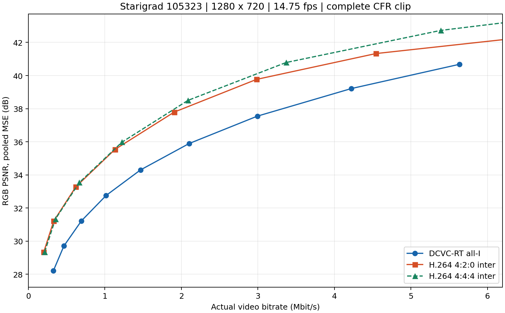
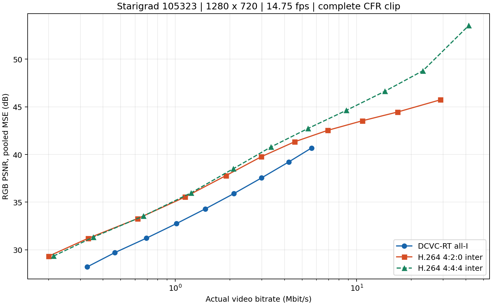

# DCVC-RT 全 I 帧与 H.264 视频编码 RD 对比

本次在同一份 `Starigrad 105323` 720P 自然视频上测试 31 个真实编码工作点。
DCVC-RT 每帧独立编码；H.264 使用帧间预测。无丢包，不含音频。

## 结果

在本视频的 DCVC-RT 实测范围（327～5635 kbps）内，
H.264 4:2:0 的 RD 曲线高于 DCVC-RT 全 I 帧曲线。在 9 个 DCVC 工作点处，
按 log(码率) 对 H.264 曲线插值得到的 PSNR 优势为
1.26～2.95 dB。这是本片段、下述参数的结果，不能外推为所有内容的结论。
H.264 利用了时间冗余，而 DCVC-RT 此处只用了图像模型；本实验不能用于评价 DCVC-RT 的 P 帧视频模型。





### 相同码率下的 PSNR

下表是对相邻实测点在 `log(码率)` 轴上做线性插值，**不是额外测量的定码率点**。

| 码率 Mbps | DCVC-RT 全 I | H.264 4:2:0 帧间 | H.264 4:4:4 帧间 |
|---:|---:|---:|---:|
| 0.5 | 29.99 | 32.57 | 32.54 |
| 1.0 | 32.69 | 35.07 | 35.17 |
| 2.0 | 35.68 | 38.00 | 38.30 |
| 4.0 | 38.95 | 40.86 | 41.50 |
| 5.0 | 40.07 | 41.60 | 42.42 |

### 所有实测点

DCVC 的 QP 是模型内部 0～63 索引，越大质量和码率越高；H.264 表中质量参数是
CRF，越小质量和码率越高。二者数字不能直接对齐。纵轴默认使用全序列 pooled RGB PSNR，
同时给出逐帧 PSNR 均值以便与旧实验核对。

| 模型/编码器 | QP 或 CRF | 实际码率 kbps | pooled RGB PSNR dB | mean-frame RGB PSNR dB |
|---|---:|---:|---:|---:|
| DCVC-RT all-I | 0 | 327.4 | 28.217 | 28.565 |
| DCVC-RT all-I | 8 | 464.0 | 29.704 | 30.014 |
| DCVC-RT all-I | 16 | 693.6 | 31.224 | 31.492 |
| DCVC-RT all-I | 24 | 1016.2 | 32.758 | 32.989 |
| DCVC-RT all-I | 32 | 1465.4 | 34.299 | 34.495 |
| DCVC-RT all-I | 40 | 2101.0 | 35.894 | 36.054 |
| DCVC-RT all-I | 48 | 2992.5 | 37.548 | 37.675 |
| DCVC-RT all-I | 56 | 4220.9 | 39.214 | 39.318 |
| DCVC-RT all-I | 63 | 5635.2 | 40.680 | 40.780 |
| H.264 4:2:0 inter | 42 | 200.3 | 29.333 | 29.516 |
| H.264 4:2:0 inter | 38 | 330.8 | 31.208 | 31.401 |
| H.264 4:2:0 inter | 34 | 620.1 | 33.279 | 33.450 |
| H.264 4:2:0 inter | 30 | 1132.1 | 35.538 | 35.685 |
| H.264 4:2:0 inter | 26 | 1904.9 | 37.789 | 37.907 |
| H.264 4:2:0 inter | 22 | 2982.2 | 39.767 | 39.846 |
| H.264 4:2:0 inter | 18 | 4542.1 | 41.327 | 41.378 |
| H.264 4:2:0 inter | 14 | 6913.7 | 42.527 | 42.569 |
| H.264 4:2:0 inter | 10 | 10751.5 | 43.536 | 43.568 |
| H.264 4:2:0 inter | 6 | 16791.3 | 44.451 | 44.474 |
| H.264 4:2:0 inter | 0 | 28958.4 | 45.736 | 45.741 |
| H.264 4:4:4 inter | 42 | 213.3 | 29.346 | 29.555 |
| H.264 4:4:4 inter | 38 | 353.5 | 31.329 | 31.551 |
| H.264 4:4:4 inter | 34 | 665.8 | 33.538 | 33.743 |
| H.264 4:4:4 inter | 30 | 1223.1 | 35.977 | 36.174 |
| H.264 4:4:4 inter | 26 | 2086.1 | 38.500 | 38.689 |
| H.264 4:4:4 inter | 22 | 3367.3 | 40.786 | 40.941 |
| H.264 4:4:4 inter | 18 | 5390.1 | 42.727 | 42.875 |
| H.264 4:4:4 inter | 14 | 8761.1 | 44.624 | 44.807 |
| H.264 4:4:4 inter | 10 | 14314.2 | 46.630 | 46.845 |
| H.264 4:4:4 inter | 6 | 23181.4 | 48.782 | 48.988 |
| H.264 4:4:4 inter | 0 | 41478.6 | 53.523 | 53.526 |

## 数据与公平性

- 同一源视频，SHA-256：`aee660c4ef1aa45dc169a0bf12bf2525869136d8dba7c1cce6a9d7b0c9f21bff`。
- 源文件包含 187 个带时间戳的视频帧；容器还有音频，容器时长不等于视频时长。
  统一按 59/4 FPS 的 CFR 时间轴生成 207 帧，共 14.033898 秒。
  FFmpeg `fps` 滤镜依据时间戳复制/丢弃帧；两种编码器接收完全相同的 RGB24 字节。
  旧丢包实验的 32 张稀疏抽帧未用于本次视频 RD 对比。
- 分辨率 1280×720；共享 RGB 原始序列 SHA-256：`eb29bf390829a3667370439c67d099f1a990848f839a25fdac7fc3bbd857600a`。
  [`reference_frame_manifest.json`](reference_frame_manifest.json) 记录每帧的时间和 RGB SHA-256。
- 源视频本身是已压缩 VP8，不是无压缩相机母版；本次衡量相对于其解码图像的再编码失真。
  源视频没有完整色彩标记，本实验统一假定 BT.709 limited YUV，转换为 full-range RGB。
- DCVC 使用官方 `DMCI` + `cvpr2025_image.pth.tar`，FP16，`force_zero_thres=0.12`，
  单熵编码器，原生整体 rANS 码流。每个 QP 均写出原生 SPS + I 帧头 + 码流，然后从保存的文件
  重新解析并解码每一帧；没有使用编码器内部重构来代替实际码流解码。
- H.264：FFmpeg `libx264`，`preset=slow`、`tune=psnr`、闭合 GOP=30、最多 3 个 B 帧、
  `scenecut=0`、4 CPU 编码线程，8-bit。4:2:0 是常用视频配置，4:4:4 为色度采样参考。
  每个点的实际 I/P/B 数量保存在 [`results.json`](results.json)；未把 H.264 强制改成全 I。
- `slow` + B 帧允许前瞻和重排，本曲线优先比较 RD 效率，不是零延迟实时编码配置。
- 码率 = 完整视频基础码流字节 × 8 / (207/14.75)，包含 DCVC SPS/帧头和 H.264
  Annex-B/SPS/PPS/SEI；不含 MP4/WebM 容器、音频、IP/UDP/RTP、FEC 或模型权重。
  完整 rANS 码流与旧容错测试的五个独立分量封装不同，不应直接复用旧封装码率。
- 主 PSNR = `10*log10(255² / 全部 RGB 像素与全部帧的平均平方误差)`；先实际解码、
  转换至 RGB24，再和共享参考比较。mean-frame PSNR 先分别计算每帧 dB 再平均，二者数值不完全相同。
  H.264 的 RGB→YUV→RGB 转换和 4:2:0 色度采样损失包含在指标内；4:4:4 曲线用于检查这一影响。
  CRF=0 仅对编码输入 YUV 无损，RGB 往返仍可能有失真，不能将它解释为 RGB 无损。

## 文件与复现

- [`rd_points.csv`](rd_points.csv)：31 个汇总工作点。
- [`results.json`](results.json)：每点字节数、码流 SHA-256、逐帧 MSE/PSNR、I/P/B 统计。
- [`environment.json`](environment.json)：帧数、帧率、GPU/框架版本、checkpoint/source/reference SHA-256。
- [`commands.json`](commands.json)：本机实际执行的全部命令。
- [`validation.json`](validation.json)：31 份码流大小/哈希、帧数、共享参考核对，以及 FFmpeg 独立 PSNR 复算。
- [`rd_curve.svg`](rd_curve.svg)：可编辑矢量曲线。
- `*_sample.png`：同一中间帧的参考和不同质量重构。
- `bitstreams/`：QP=32 的完整 DCVC 基础码流和 CRF=30 的两种 H.264 基础码流，供实际解码复查。
  其他码流保留在本机 work 目录，均有 SHA-256，可通过脚本重新生成。
- [`SOURCE_LICENSE.md`](SOURCE_LICENSE.md)：视频和派生图像的来源、许可。

从 `DCVC-family/DCVC-RT` 执行（需要 checkpoint、FFmpeg、PyTorch CUDA 和 rANS 扩展）：

```bash
python local_tests/rd_comparison/run_rd_comparison.py \
  --source local_tests/natural_720p/starigrad_105323_720p.webm \
  --checkpoint checkpoints/cvpr2025_image.pth.tar \
  --work /data/dcvc_h264_rd_work \
  --output local_tests/results/dcvc_i_vs_h264_rd_reproduction
```

Windows 主控 + WSL 推理时，追加
`--wsl --dcvc-python /home/qinyi/.local/share/dcvc-rt/venv/bin/python`。
工作目录保存较大的原始 RGB 和全部码流，结果目录需为新路径。文件读取/编码失败或
解码帧数不一致时脚本会报错；两种编码器的参考 SHA-256 必须一致。

实验结束后执行独立审计（路径与上面相同）：

```bash
python local_tests/rd_comparison/verify_rd_results.py \
  --output local_tests/results/dcvc_i_vs_h264_rd_reproduction \
  --work /data/dcvc_h264_rd_work
```

本次设备：NVIDIA GeForce RTX 3070，PyTorch 2.4.1+cu121，
CUDA 12.1，自定义 CUDA 算子启用状态：
`False`（False 表示项目 PyTorch fallback）。
H.264 和 DCVC 为节省实验时间并行运行；日志中的耗时仅供诊断，未据此比较 FPS。

官方参数参考：[FFmpeg libx264 文档](https://ffmpeg.org/ffmpeg-codecs.html#libx264_002c-libx264rgb)、
[DCVC-RT 上游](https://github.com/microsoft/DCVC/tree/main/DCVC-family/DCVC-RT)。
