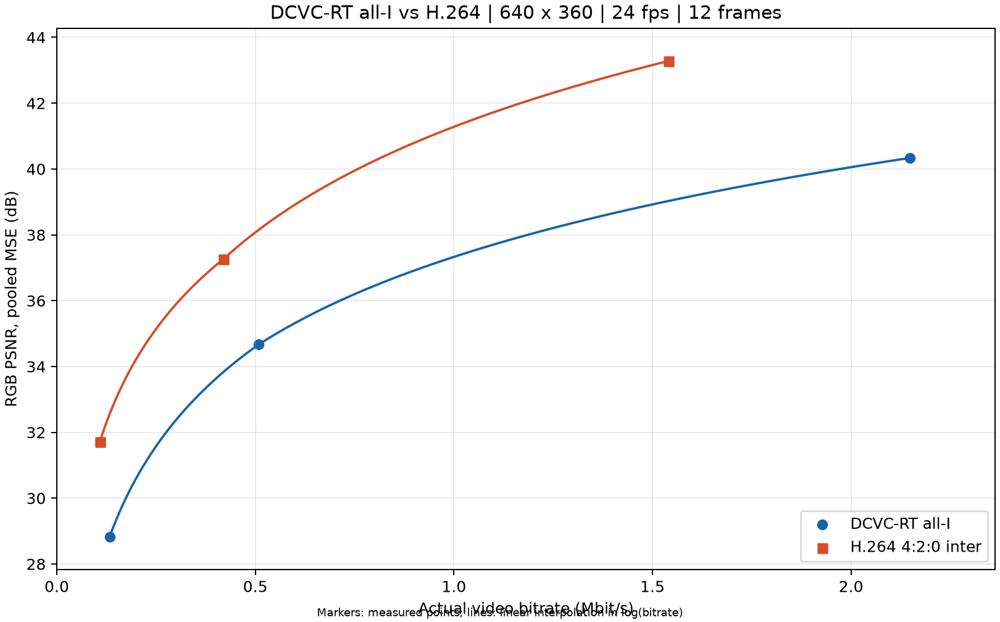

# MP4 替换与旧版 FFmpeg 兼容性验证（2026-10-14）

本目录验证代码可处理替换视频，并修复不支持 `fps_mode` 的 FFmpeg 调用。
**这是公开自然视频转换得到的测试 MP4，不是用户尚未提供路径的那份 MP4。**
片段和质量点用于验证管线，不应当作完整视频 RD 基准或跨内容结论。

完整使用步骤见 [MP4 替换、运行、出图指南](../../rd_comparison/README.md)。
旧的 207 帧正式实验仍见 [2026-10-13 报告](../dcvc_i_vs_h264_rd_20261013/README.md)。

## 真实兼容性测试

| 环境 | 输入 | 测试 | 结果 |
|---|---|---|---|
| Windows FFmpeg 8.1 + WSL CUDA worker | MP4/H.264/AAC、640×360、24 FPS、路径含空格 | 12 帧，3 个 DCVC QP + 3 个 H.264 CRF | [PASS](modern/validation.json) |
| Windows FFmpeg **4.2.2** + WSL CUDA worker | 同一 MP4 | 12 帧，QP 0/32/63、CRF 38/26/14 | [PASS](legacy/validation.json) |
| Linux/WSL FFmpeg **4.4** + FFprobe 4.4 + CUDA worker | 同一 MP4 | 同样 12 帧、6 点，原生 Linux 调用 | [PASS](linux44/validation.json) |

另测了 `--start 0.5 --duration 0.5 --fps 12 --width 320 --height 180`、
QP 0/16、CRF 38/26、4:2:0 + 4:4:4，成功处理 6 帧并通过独立 PSNR 校验。
这里不要求 CRF=0、31 个点、720P 或 14.75 FPS。

源 MP4 可[直接下载](input%20clip.mp4)，来源及派生许可见 [SOURCE_LICENSE.md](SOURCE_LICENSE.md)。
源 SHA-256：`ca6be6e9d96b29fc6a4b844cdd2375d427c3881ee1f332e62a48da4d5f4b9e7a`。

## 确认 `fps_mode` 报错已修复

先用 FFmpeg 4.2.2 实际执行旧选项，得到：

```text
Unrecognized option 'fps_mode'.
Error splitting the argument list: Option not found
```

见 [原始报错日志](legacy_fps_mode_rejection.log)、[旧工具版本及 SHA-256](legacy_tool.json)。
然后同一 FFmpeg 4.2.2 执行新版脚本，所有转换使用 `-vsync 0`，顺利编解码及出图。
新版也在 Linux FFmpeg 4.4 上完整跑通，因此不需要为了本修复升级到支持 `fps_mode` 的新版本。

FFmpeg 4.2.2 测试使用 FFprobe 8.1 做元数据读取；Linux 4.4 测试使用成套 FFmpeg/FFprobe 4.4。

## 独立 PSNR 复算

- FFmpeg 8.1：NumPy 45.5128927904 dB，FFmpeg 45.512893 dB。
- FFmpeg 4.2.2：NumPy 43.2811581858 dB，FFmpeg 43.281158 dB。
- FFmpeg 4.4：NumPy 43.2811581858 dB，FFmpeg 43.281158 dB。

每个环境内使用完全相同的参考 RGB，实际输出码流大小/哈希、解码帧数和每帧 MSE 均核对通过。
8.1 的复算点是 CRF=0，4.2.2/4.4 是 CRF=14；这里验证评分一致性，不比较这三个数值高低。

## 示例曲线

以下为 Linux FFmpeg 4.4 测试样例：



主图显示 DCVC 工作范围；[对数坐标图](linux44/rd_curve_log.png)显示完整范围。
点为实测；连线按 log(码率) 插值。正式测试建议使用默认 9+11 个质量点及更长片段。

## 进程与出图回归测试

Windows 与 Linux 均通过 7 项测试：

1. stdout/stderr 各输出 2 MB 时不阻塞；
2. 非零退出能返回错误并保留日志；
3. 无日志增长的进程按 idle-timeout 终止；
4. 持续输出但不结束的进程按总 timeout 终止；
5. stdin 为关闭状态，不能等待键盘交互；
6. MP4 实测命令全部使用 `-nostdin` / `-vsync 0`，没有 `-fps_mode`；
7. 新视频名、非固定尺寸/点数、不重叠码率范围和省略 4:4:4 时仍可生成报告与曲线。

另已验证 `--plot-only` 在 FFmpeg 不存在时仍能出图，且不改变 results.json、environment.json 和 README.md。
检查记录见 [compatibility_checks.json](compatibility_checks.json)；单测日志见
[Windows](unit_tests_windows.log) / [Linux](unit_tests_linux.log)。

卡住的具体根因不能仅凭现象确定。这里验证的是取消交互等待、实时日志、有限等待和超时终止，
没有把原先的 `subprocess.run(capture_output=True)` 宣称为已证实的死锁来源。
