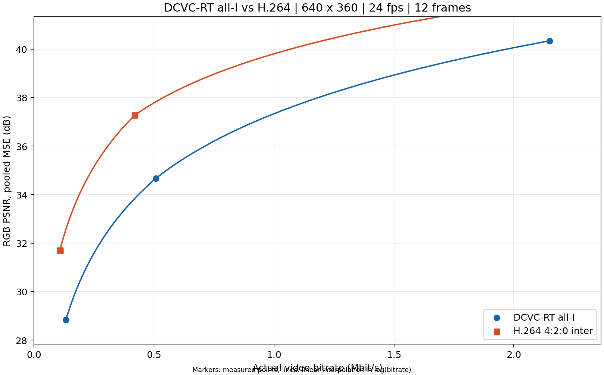
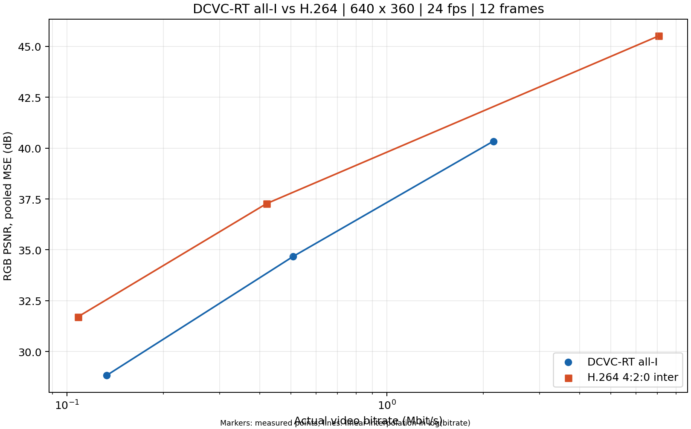

# DCVC-RT 全 I 帧与 H.264 视频 RD 对比

输入：`input clip.mp4`。
共 6 个真实编码工作点，12 帧，
640×360，24 FPS，
时长 0.500000 秒。两种编码器使用同一份解码后的 RGB24 参考。

在 3 个共同码率范围内的 DCVC 点上，H.264 4:2:0 减去 DCVC 的 PSNR 差值为 1.70～3.73 dB（H.264 按 log(码率) 插值，正值表示 H.264 更高）。

| 编码器 | QP / CRF | 实际码率 kbps | pooled RGB PSNR dB | mean-frame RGB PSNR dB |
|---|---:|---:|---:|---:|
| DCVC-RT all-I | 0 | 133.1 | 28.832 | 28.896 |
| DCVC-RT all-I | 32 | 508.4 | 34.670 | 34.751 |
| DCVC-RT all-I | 63 | 2148.7 | 40.337 | 40.413 |
| H.264 4:2:0 inter | 38 | 108.2 | 31.708 | 31.735 |
| H.264 4:2:0 inter | 26 | 420.1 | 37.269 | 37.293 |
| H.264 4:2:0 inter | 0 | 7068.4 | 45.513 | 45.513 |

## 方法

- DCVC：官方 DMCI、FP16、force_zero_thres=0.12，每帧独立编码；实际保存 SPS、I 帧头及 rANS 码流并重新读取解码。
- H.264：libx264，slow + tune=psnr，闭合 GOP=30，最多 3 个 B 帧，scenecut=0，4 个编码线程。
  帧间预测利用时间冗余，本结果不评价 DCVC 的 P 帧模型，也不代表 H.264 零延迟配置。
- CFR 参考采用源帧率或用户指定帧率；依据时间戳复制/丢弃帧。尺寸、片段和色彩转换见 environment.json / commands.json。
- 色彩处理：input bt601/tv -> shared RGB24 -> codec; H.264 BT.709 limited YUV。
  输入 MP4 若已压缩，本次 PSNR 相对于其解码图像，不是相机无压缩母版。
- 码率按完整基础码流字节×8/共同片段时长计算，含 DCVC 帧头和 H.264 SPS/PPS/SEI，
  不含音频、容器、传输头、FEC 或模型权重。无丢包。
- 主 PSNR 对所有 RGB 像素和帧的 MSE 汇总后取 dB；另存逐帧 dB 均值。
  H.264 的色彩转换/色度采样失真也计入。CRF=0 对输入 YUV 无损，RGB 往返不一定无损。
- DCVC QP 越大质量越高；H.264 CRF 越小质量越高，数字不能跨模型比较。

## 证据与复现

- [rd_points.csv](rd_points.csv)、[results.json](results.json)：汇总及逐帧结果。
- [environment.json](environment.json)、[commands.json](commands.json)：软件、数据、参数和全部命令。
- [reference_frame_manifest.json](reference_frame_manifest.json)：每帧 RGB SHA-256。
- `bitstreams/` 和 `*_sample.png`：代表性真实码流与中间帧重构。
- [使用指南](https://github.com/qinyishcn/DCVC/blob/main/DCVC-family/DCVC-RT/local_tests/rd_comparison/README.md)：替换 MP4、运行、验证、仅重新出图的步骤。

源文件 SHA-256：`ca6be6e9d96b29fc6a4b844cdd2375d427c3881ee1f332e62a48da4d5f4b9e7a`。

共享 RGB SHA-256：`6f745e2522daf64c1bc40f535f45022c0476815e94972df4932bcfc02353d79c`。

checkpoint SHA-256：`555eff5f4026774f477bebdcbb3b52548e0da230803959dcebcea4d732a90dd9`。
